# Client Demo Playbook — Magpie Gateway

::: callout
**How to use this guide (Josh):** Keep this playbook on your second monitor during the client session. Every act gives you **(1) what to say**, **(2) exact UI clicks or copy-paste terminal commands**, and **(3) the exact screen/output the client will see**. The demo runs locally on your laptop using our 8-container zero-trust sandbox — no live internet API keys or customer data required.
:::

## Preflight: 5-Minute Setup Before Joining the Call

### 1. Start the Multi-Container Demo Environment

From the `magpie-gateway` repository root, run:

```bash
docker compose -f deploy/compose/e2e/docker-compose.yml up -d --build
```

Verify all 8 containers are running and pre-seed the demo environment (approved models, SCIM groups, SIEM sink, and baseline audit records):

```bash
python3 deploy/compose/e2e/run_e2e.py
```

You should see **`ALL 22 MULTI-CONTAINER E2E CHECKS PASSED!`** in ~20 seconds.

### 2. Arrange Your Screen

Put two windows side by side on your shared display:

| Window | Position | What to Open |
|---|---|---|
| **Browser (Chrome/Edge)** | Left 60% | `http://127.0.0.1:8088/ui/control-centre` (logged in as `admin`) |
| **Terminal** | Right 40% | Clean shell in `magpie-gateway` with large font (16pt+) for running live commands inside the onboarded agent containers |

### 3. Demo Credentials & Endpoints

| Resource | URL / Value | Notes |
|---|---|---|
| **Magpie Portal UI** | `http://127.0.0.1:8088` | Admin login: `admin` / `MagpieDemoAdmin2026!` |
| **Second Approver (Four-Eyes)** | `http://127.0.0.1:8088` | Approver login: `approver@agency.gov.au` / `MagpieApprover2026!#` |
| **Agentgateway LLM Proxy** | `http://127.0.0.1:4000/v1` | Enforces strict virtual API keys + request/response webhooks |
| **Agentgateway MCP Proxy** | `http://127.0.0.1:3000/mcp` | Enforces CEL tool allow-list (`example_search` only) |
| **Live Mock Upstream Counter** | `http://127.0.0.1:8090/stats` | Proves blocked prompts **never** reached the upstream LLM |
| **Live Mock SIEM Receiver** | `http://127.0.0.1:8095/events` | Proves live audit batches stream out to Sentinel/OTLP |

### 4. Know the Three Onboarded Agent Containers

Explain to the client that we have **three isolated Linux containers** simulating real enterprise staff and AI agents. They live on an isolated `magpie-agents` Docker network — they **cannot** reach the upstream LLM, MCP server, or portal webhooks directly; every call must pass through Magpie Gateway.

| Container Name | Persona | Simulated Tool | Virtual Key Cohort | Default Behaviour |
|---|---|---|---|---|
| `agent-pilot` | Alice Chen (`alice.chen@agency.gov.au`) | Claude Code | `ai-pilot-enforced` | **Enforcing** (DLP, Sovereignty & PSPF actively block) |
| `agent-trial` | Bob Smith (`bob.smith@agency.gov.au`) | OpenAI Codex | `ai-trial-observe` | **Log-Only Trial** (logs violations without blocking user) |
| `agent-mcp` | Carol Jones (`carol.jones@agency.gov.au`) | Ops MCP Agent | `ai-ops-enforced` | Calls both LLM + MCP tools (`example_search` / `example_admin`) |

---

## Solution Architecture Walkthrough (4 Minutes)

Start the meeting by walking the client through the production AWS Sovereign Solution Architecture diagram.

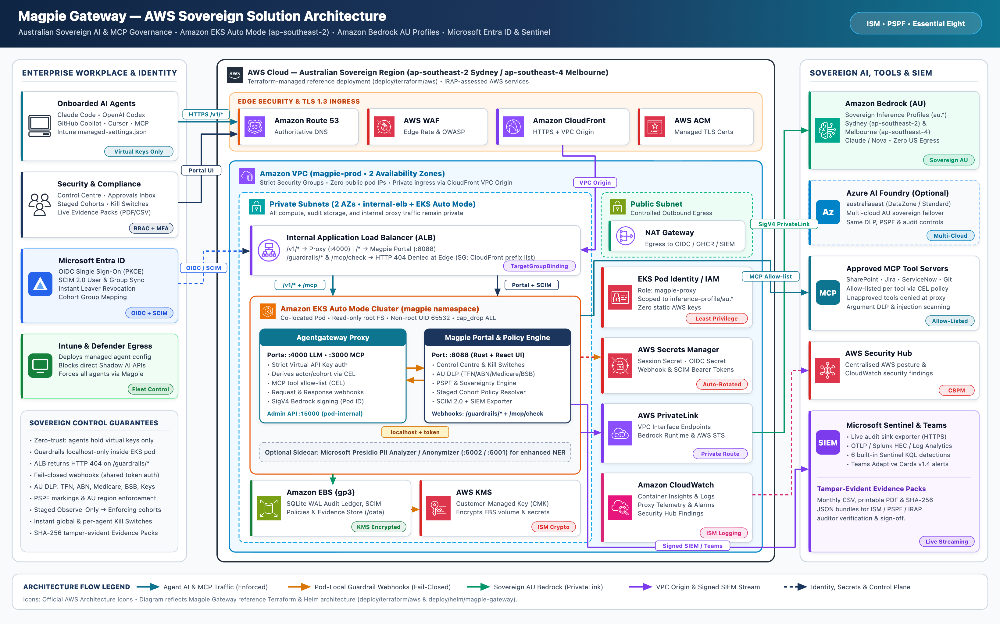

### Key Talking Points for CIOs, CISOs & Cloud Architects

1. **Zero-Trust Edge & Private Compute (ap-southeast-2 Sydney / ap-southeast-4 Melbourne):**
   - Deployed via our ready-to-run Terraform module (`deploy/terraform/aws`) into **Amazon EKS Auto Mode** inside private subnets across two Availability Zones.
   - Traffic enters through **Amazon Route 53**, **AWS WAF**, and **Amazon CloudFront** with a **VPC Origin** to an **Internal Application Load Balancer (ALB)**.
   - The ALB explicitly returns **HTTP 404** for `/guardrails/*` and `/mcp/check` — policy webhooks are **pod-local (`localhost`) only**, authenticated with a shared secret token, and fail-closed.
2. **Sovereign AI with Zero Static AWS Keys:**
   - The Agentgateway proxy authenticates to **Amazon Bedrock** using **EKS Pod Identity** scoped strictly to Australian inference profiles (`inference-profile/au.*` in Sydney & Melbourne) over **AWS PrivateLink**.
   - Optional multi-cloud failover to **Azure OpenAI / AI Foundry (`australiaeast`)** is supported through the same gateway and policy engine.
3. **Fits Straight Into a Microsoft Enterprise Estate:**
   - **Microsoft Entra ID** drives OIDC SSO, SCIM 2.0 user/group sync, cohort mapping, and instant leaver session revocation.
   - **Microsoft Intune & Defender for Endpoint** push managed agent settings (`managed-settings.json`, `config.toml`) and block direct Shadow AI egress so every developer and agent routes through Magpie.
   - **Microsoft Sentinel** receives live streamed audit events (with 6 built-in KQL detections) alongside **Microsoft Teams Adaptive Cards v1.4** alerts and **KMS-encrypted EBS** storage for SHA-256 tamper-evident Evidence Packs.

---

## Act 1 — Sign-In & Unified Control Centre (5 Minutes)

### Step 1.1 — Show the Sign-In Experience

Open `http://127.0.0.1:8088/ui/login` (or show the screenshot before signing in).

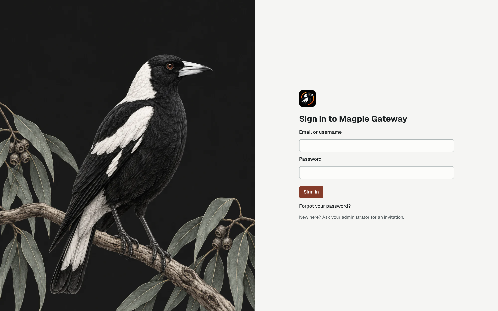

**What to say:**
> "In production, administrators sign in with **Microsoft Entra ID SSO** with phishing-resistant MFA. Local break-glass login is strictly audited and off by default unless needed for recovery."

Sign in as `admin` / `MagpieDemoAdmin2026!`.

### Step 1.2 — Tour the Control Centre

Navigate to **Control Centre** (`/ui/control-centre`).

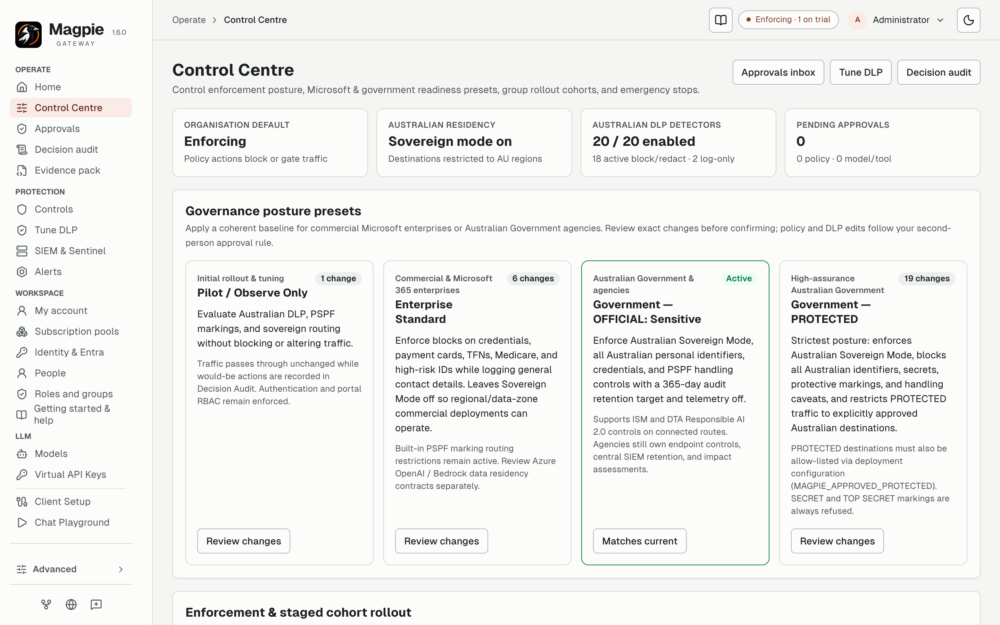

**What to show & say:**
1. **Top Status Strip:** Point out the live operational state at a glance — active enforcement mode, Australian Data Sovereignty status, active kill switches, and pending approvals count.
2. **Four Plain-English Posture Presets:**
   - *Pilot / Observe-Only* — safe Day-1 rollout; logs what would be blocked without breaking a single developer's workflow.
   - *Enterprise Standard* — enforces DLP, secrets protection, and approved models/tools.
   - *Australian Government — OFFICIAL:Sensitive* — adds strict Australian region residency, 365-day audit retention, and full Australian identifier DLP.
   - *Australian Government — PROTECTED* — strictest posture requiring explicit PROTECTED-approved destinations.
3. **Click "Preview changes"** on a preset card to show the **before/after diff table** — nothing applies silently or unexpectedly.

---

## Act 2 — Live Multi-Agent Staged Rollout & Australian DLP (7 Minutes)

This is the **"wow" moment** of the demo. Switch to your split screen so the client sees your terminal on the right and the Portal UI on the left.

### Step 2.1 — Prove Zero-Trust Isolation & Strict Virtual API Keys

Run in your terminal:

```bash
# 1. Inspect Alice's onboarded agent container profile
docker compose -f deploy/compose/e2e/docker-compose.yml exec -T agent-pilot magpie-agent whoami

# 2. Prove the agent CANNOT bypass Magpie to reach the upstream LLM directly
docker compose -f deploy/compose/e2e/docker-compose.yml exec -T agent-pilot \
  curl -sS --max-time 2 http://mock-llm:8090/healthz || echo "BLOCKED BY NETWORK ISOLATION"

# 3. Prove an agent without a valid virtual API key is rejected (HTTP 401)
docker compose -f deploy/compose/e2e/docker-compose.yml exec -T agent-pilot \
  magpie-agent chat "Hello without a key" --no-key --allow-http-error
```

**What to say:**
> "Notice two things: first, Alice's container has zero upstream AWS or OpenAI credentials — only a Magpie virtual key. Second, even if an agent tries to go around the gateway, network isolation blocks it; and any request without a valid virtual key gets an immediate HTTP 401."

### Step 2.2 — Clean Sovereign Prompt Succeeds

```bash
docker compose -f deploy/compose/e2e/docker-compose.yml exec -T agent-pilot \
  magpie-agent chat "Summarise Australian ISM logging principles in two sentences."
```

**Expected result:** `HTTP 200` with a sovereign response from `au-sovereign-llm` (`ap-southeast-2`).

### Step 2.3 — Enforced Cohort Blocks Synthetic Australian ABN & TFN (Zero Upstream Leaks)

Check the upstream LLM call counter *before* sending sensitive Australian identifiers, then send a synthetic ABN and TFN from **Alice (`agent-pilot`, Enforcing cohort)**:

```bash
# Check upstream LLM counter BEFORE
curl -s http://127.0.0.1:8090/stats | jq '.count'

# Send synthetic Australian ABN + TFN from Alice (Enforcing cohort)
docker compose -f deploy/compose/e2e/docker-compose.yml exec -T agent-pilot \
  magpie-agent chat "Review contractor ABN 51 824 753 556 and TFN 123 456 782 for FY26." --allow-http-error

# Check upstream LLM counter AFTER — still identical!
curl -s http://127.0.0.1:8090/stats | jq '.count'
```

**Expected result:** `HTTP 400` blocked by Magpie Gateway Australian DLP, and the upstream `mock-llm` count **did not increment by even 1**. Zero sensitive data ever left the gateway.

### Step 2.4 — Same Prompt in Observe-Only Trial Cohort Passes & Logs

Now run the **exact same prompt** from **Bob (`agent-trial`, Observe-Only cohort)**:

```bash
docker compose -f deploy/compose/e2e/docker-compose.yml exec -T agent-trial \
  magpie-agent chat "Review contractor ABN 51 824 753 556 and TFN 123 456 782 for FY26."
```

**Expected result:** `HTTP 200` succeeds cleanly so Bob's pilot group is never disrupted while security verifies false-positive rates!

### Step 2.5 — Show Live Australian DLP Tuning & Decision Audit in the Portal

In the browser, click **Australian privacy (DLP)** (`/ui/dlp-tuning`) and then **Audit log** (`/audit`).

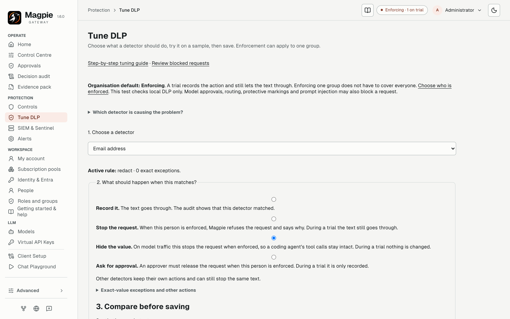

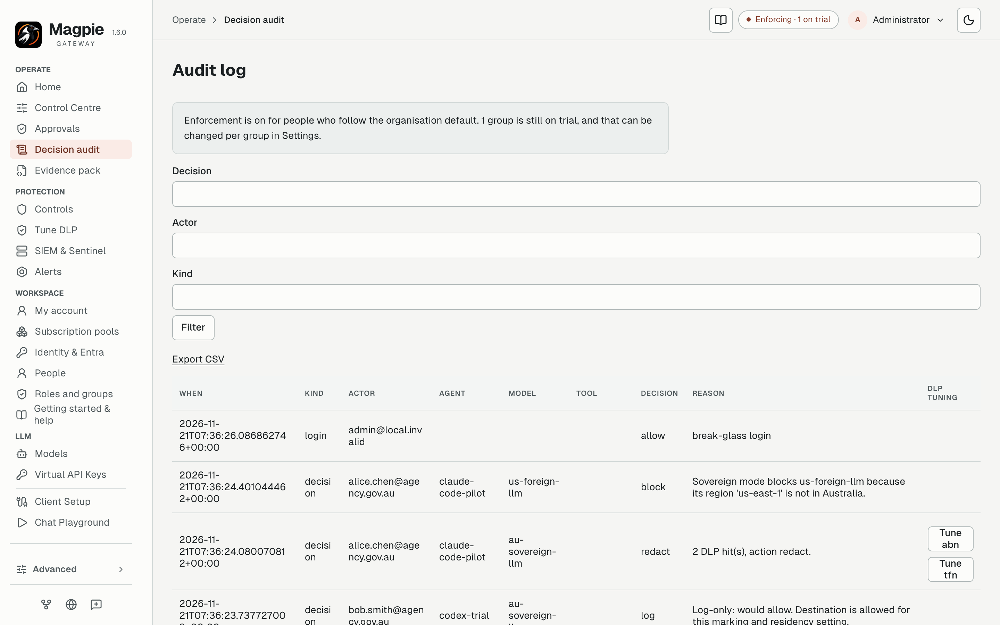

**What to say:**
> "Every Australian identifier — TFN, ABN, ACN, Medicare, BSB, Australian phone/passport, plus API keys and private keys — is validated with real checksums, not crude regexes. And right here in Decision Audit you can see Alice's blocked call next to Bob's observed call, complete with exact cohort source and timestamps."

---

## Act 3 — Australian Data Sovereignty, PSPF Markings & Response Scrubbing (5 Minutes)

Run these three high-impact commands back to back in your terminal:

```bash
# 1. Sovereignty: Alice calls an APPROVED US model (us-foreign-llm in us-east-1) -> BLOCKED!
docker compose -f deploy/compose/e2e/docker-compose.yml exec -T agent-pilot \
  magpie-agent chat "Draft a ministerial briefing outline." --model us-foreign-llm --allow-http-error

# 2. PSPF Classification: Alice sends a PROTECTED document to an unapproved destination -> BLOCKED!
docker compose -f deploy/compose/e2e/docker-compose.yml exec -T agent-pilot \
  magpie-agent chat "Draft cabinet notes." --marking PROTECTED --allow-http-error

# 3. Response-Phase Guardrail: Upstream LLM tries to leak a TFN in its reply -> SCRUBBED!
docker compose -f deploy/compose/e2e/docker-compose.yml exec -T agent-pilot \
  magpie-agent chat "Please run TRIGGER_LEAK_TFN diagnostic"
```

**What to point out to the client:**
- **Command 1:** Even though `us-foreign-llm` is approved in the catalogue, **Australian Sovereign Mode** stops any traffic destined outside Australia (`us-east-1`) before it leaves the VPC.
- **Command 2:** PSPF `PROTECTED` markings are blocked automatically unless the destination is explicitly accredited for PROTECTED workloads.
- **Command 3:** Look at the JSON response body — the upstream model tried to return `TFN 123 456 782`, and Magpie's **response guardrail** intercepted and redacted it *before* it reached Alice's workstation!

---

## Act 4 — Four-Eyes Approvals & MCP Tool Governance (5 Minutes)

### Step 4.1 — Show the Approvals Inbox

In the browser, open **Approvals** (`/ui/approvals`).

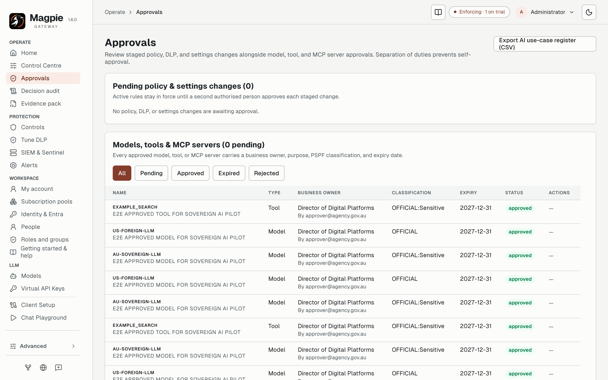

**What to say:**
> "In Magpie, unapproved models and MCP tools are **denied by default**. Every approval captures business owner, purpose, PSPF classification, and an automatic expiry date — and **four-eyes separation of duties** is enforced at the API layer: the person who submits a model or tool literally receives HTTP 403 if they try to approve their own request."

### Step 4.2 — Live MCP Tool Allow-List Demo (`agent-mcp`)

Run Carol's autonomous ops agent (`agent-mcp`) against two MCP tools on the internal `notes` server:

```bash
# 1. Call UNAPPROVED privileged tool (example_admin) -> BLOCKED at proxy!
docker compose -f deploy/compose/e2e/docker-compose.yml exec -T agent-mcp \
  magpie-agent mcp-call example_admin

# 2. Call APPROVED read-only tool (example_search) -> ALLOWED!
docker compose -f deploy/compose/e2e/docker-compose.yml exec -T agent-mcp \
  magpie-agent mcp-call example_search

# 3. Prove the backend notes server NEVER saw example_admin
docker compose -f deploy/compose/e2e/docker-compose.yml exec -T notes cat /log/calls.log
```

**What to say:**
> "Even if a compromised prompt tries to make an AI agent invoke `example_admin`, Agentgateway enforces Magpie's CEL allow-list at the proxy — the backend server log proves `example_admin` never even arrived."

*(Optional for technical audiences: click **Gateway Console** (`/ui/`) to show the live native Agentgateway console bridged straight through Magpie's RBAC layer.)*

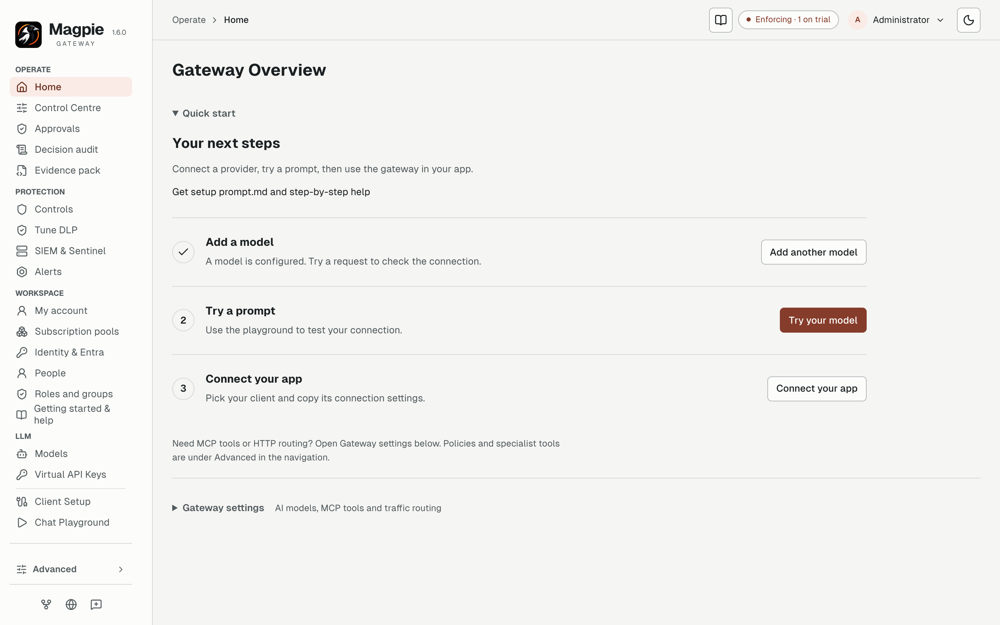

---

## Act 5 — Emergency Kill Switches (3 Minutes)

Stay on **Control Centre** (`/ui/control-centre`) in the browser and scroll to **Emergency Kill Switches**.

### Step 5.1 — Surgical Per-Agent Stop

1. In the UI, add `claude-code-pilot` to the **Paused agents** list and click **Save kill switch** (or trigger via API).
2. Run in terminal:

```bash
# Alice's agent is stopped IMMEDIATELY (even for a harmless greeting!)
docker compose -f deploy/compose/e2e/docker-compose.yml exec -T agent-pilot \
  magpie-agent chat "Hello, are you there?" --allow-http-error

# Meanwhile, Carol's ops agent continues working completely unaffected!
docker compose -f deploy/compose/e2e/docker-compose.yml exec -T agent-mcp \
  magpie-agent chat "Health ping from ops agent"
```

### Step 5.2 — Global Emergency Stop & Instant Recovery

1. Toggle **Global kill switch** ON in the Control Centre -> show Carol's `agent-mcp` is now halted too.
2. Clear both kill switches -> re-run `agent-pilot` -> recovers in under 1 second!

**What to say:**
> "If a SOC analyst spots a runaway autonomous agent at 2 AM, they don't have to take down AI for the entire department — they isolate that single agent in one click, and still have a global brake if there's an agency-wide incident."

---

## Act 6 — Microsoft Enterprise Stack & Live Auditor Evidence Pack (6 Minutes)

Walk quickly through the four enterprise governance views populated with live data from the session you just ran:

### Step 6.1 — Microsoft Entra ID & Persistent SCIM 2.0 (`/ui/identity`)

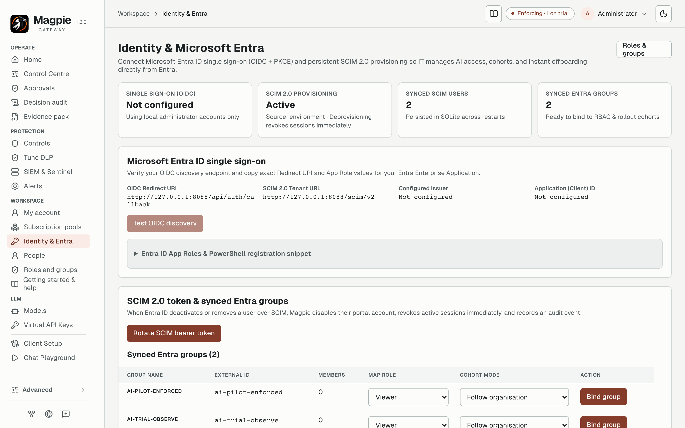

**Talking points:**
- Guided Entra Enterprise Application setup with **Test OIDC Discovery**.
- SCIM 2.0 users and groups persist in SQLite across container restarts (`ai-pilot-enforced` and `ai-trial-observe` are visible right here!).
- When HR disables a leaver in Entra ID, SCIM `PATCH active=false` revokes their active Magpie sessions immediately.

### Step 6.2 — Enterprise Fleet Rollout with Intune & Defender (`/ui/llm/client-setup`)

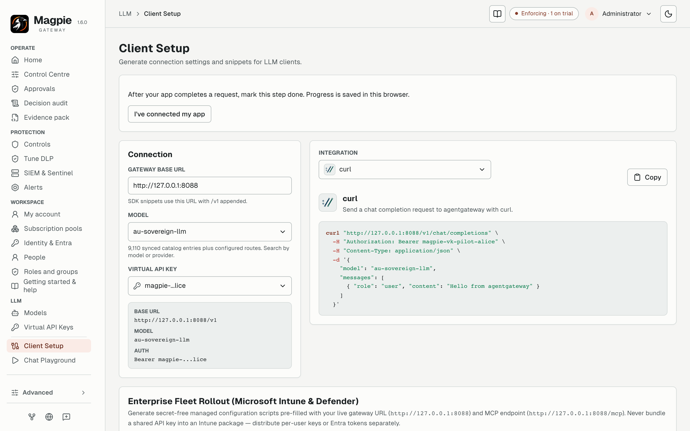

**Talking points:**
- One-click downloadable configs for Claude Code (`managed-settings.json`), OpenAI Codex (`config.toml`), Copilot, and Cursor.
- Built-in **Microsoft Intune** PowerShell remediation scripts and **Microsoft Defender for Endpoint** Shadow AI egress-blocking indicators so staff cannot bypass Magpie to hit `api.openai.com` or `api.anthropic.com` directly.

### Step 6.3 — Live Microsoft Sentinel / SIEM Streaming (`/ui/siem`)

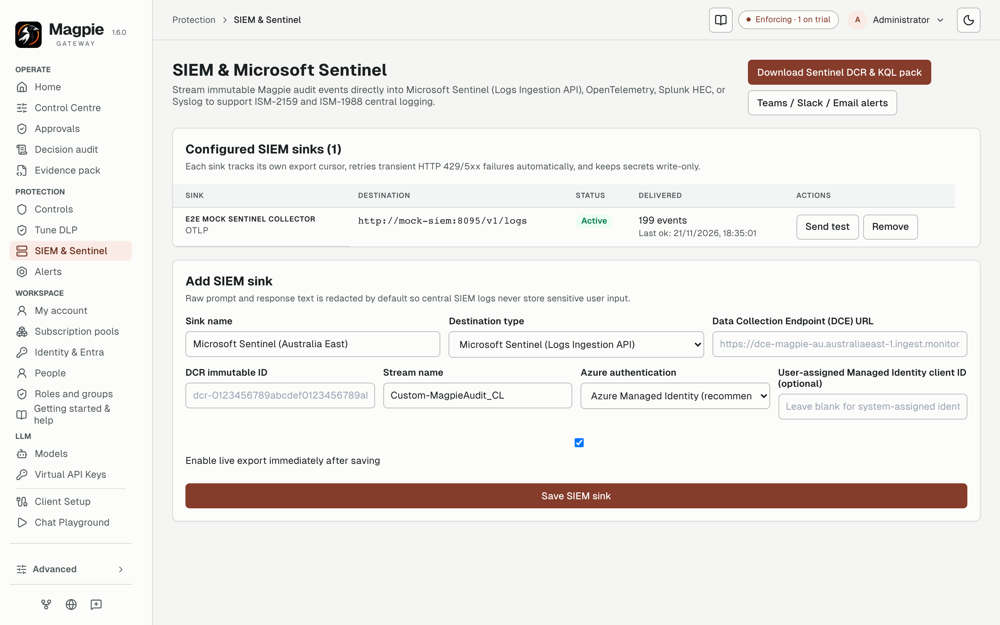

Show the live counter in the UI **and** inspect the real batches received by our `mock-siem` container:

```bash
curl -s http://127.0.0.1:8095/events | jq '{batchesReceived: .count, latestPath: .batches[-1].path}'
```

**Talking points:**
- Supports **Microsoft Sentinel Logs Ingestion API** (Managed Identity or Entra Client Credentials), OTLP, Splunk HEC, and Syslog HTTP.
- Ships with **6 ready-to-import Sentinel KQL detection rules** (DLP block spikes, after-hours spikes, blocked foreign destinations, unapproved MCP tools, credential leaks, tool-call sprees) and **Microsoft Teams Adaptive Cards v1.4** alerting.

### Step 6.4 — Live Compliance & Tamper-Evident Evidence Pack (`/ui/evidence`)

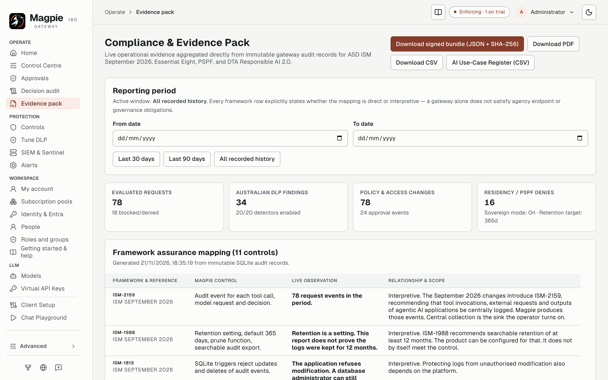

**Talking points (close strong here!):**
- Point to the live numbers generated during *this exact demo* (real requests, blocks, DLP hits, sovereign denies, policy changes).
- Show the honest framework mapping table covering **ISM September 2026 (`ISM-2159`, `ISM-1988`, `ISM-1815`)**, **Essential Eight**, **DTA AI Policy 2.0**, and the **Agentic AI Addendum (`AGT.3`, `AGT.4`, `AGT.7`, `AGT.8`)**.
- Click **Download PDF** and **Download SHA-256 Pack (JSON)** — hand the client a real auditor-ready evidence artefact generated from the traffic they just watched!

---

## Resetting Between Client Demos (60 Seconds)

To reset the database, mock counters, and audit log to a crisp, fresh state before your next client session:

```bash
# 1. Tear down volumes for a 100% clean slate
docker compose -f deploy/compose/e2e/docker-compose.yml down -v

# 2. Bring the 8-container stack back up
docker compose -f deploy/compose/e2e/docker-compose.yml up -d

# 3. Re-seed approvals, SCIM cohorts, SIEM sink, and baseline traffic
python3 deploy/compose/e2e/run_e2e.py
```

---

## Client Q&A & Objection Handling Cheat Sheet

| Client Question | Best Answer for Josh |
|---|---|
| **"Does this add noticeable latency to coding agents?"** | Sub-10 ms overhead. Agentgateway is written in Rust, and Magpie's guardrail engine runs co-located over `localhost` in the same EKS pod with in-process compiled recognisers — zero extra external network hops. |
| **"Is Magpie Gateway IRAP-certified?"** | Be transparent and build trust: *software alone cannot be IRAP-certified* — agencies assess their own hosted system. Magpie runs on IRAP-assessed AWS Sydney/Melbourne or Azure Australia East services, ships KMS encryption, four-eyes approvals, append-only audit logs, and honest ISM/PSPF/Agentic AI Evidence Packs that cut IRAP assessment prep dramatically. |
| **"We are a Microsoft / Azure shop — do we have to run on AWS?"** | No. We ship production Terraform for **both** AWS EKS Auto Mode + Bedrock (`deploy/terraform/aws`) and Azure Container Apps + Azure AI Foundry `australiaeast` (`deploy/terraform/azure` + `Deploy-MagpieAzure.ps1`). You can even run the gateway in one cloud and route sovereign models across both. |
| **"How do you stop developers bypassing the gateway with personal API keys?"** | Three layers: (1) Developers never receive raw provider keys — only Magpie virtual keys tied to their Entra identity; (2) Intune pushes managed settings pointing CLI/IDE agents to Magpie; (3) Microsoft Defender for Endpoint / corporate firewall blocks direct egress to `api.openai.com`, `api.anthropic.com`, etc. |
| **"Will turning this on break our engineering teams on Day 1?"** | Never. Start in **Pilot / Observe-Only** mode, onboard teams via Intune, inspect real DLP hits in Decision Audit, tune any internal false positives, and promote one Entra ID group at a time to **Enforcing** from the Control Centre. |
| **"What if our LLM provider leaks sensitive data or prompt injection comes back from an MCP tool?"** | Magpie inspects **both directions** — request guardrails stop outbound PII/secrets/sovereignty violations before they leave the VPC, and response guardrails scan LLM replies and MCP tool outputs for PII leakage and prompt-injection patterns. |
| **"Can our SOC see everything in Microsoft Sentinel?"** | Yes — configure a Microsoft Sentinel DCR sink directly in the portal (using Managed Identity or Entra app credentials), test delivery with one click, and import our 6 built-in Sentinel KQL detection rules. |
| **"How fast can we run a pilot?"** | Docker Compose / container sandbox runs in 5 minutes; a production AWS or Azure sovereign pilot deploys via Terraform in under 30 minutes and connects to Entra ID + Sentinel the same afternoon. |
