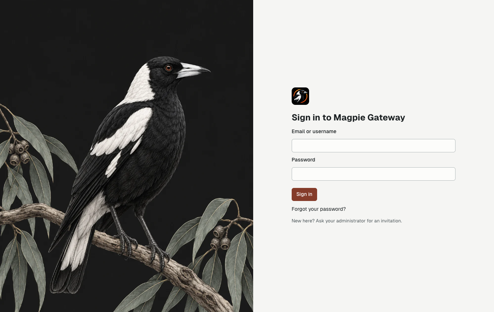

# Getting started

This walkthrough shows how to sign in to Magpie Gateway with Microsoft Entra ID (or a local recovery account), understand the unified console navigation, check live enforcement status, and confirm your role permissions.

## Who this is for

Every user who signs in to Magpie Gateway. Access is governed by six built-in roles (or custom per-action roles created under **Roles and groups**):

| Built-in role | Entra App Role value | Key permissions |
|---|---|---|
| **Owner** | `Magpie.Owner` | Every portal and gateway action (reserved; cannot be narrowed or deleted) |
| **Admin** | `Magpie.Admin` | Full gateway, Control Centre, SIEM, Alerts, and access administration (editable) |
| **Policy Editor** | `Magpie.PolicyEditor` | View Controls, tune DLP, edit policies, submit approvals, export policy documents |
| **Approver** | `Magpie.Approver` | View policies and approve or reject another person's staged changes and tool/model requests |
| **Auditor** | `Magpie.Auditor` | Read-only Decision Audit, Controls, Settings, and Compliance Evidence Pack exports |
| **Viewer** | `Magpie.Viewer` | Read-only dashboard and approved model/tool catalogue |

::: note
Users who authenticate for the first time without a matching Entra App Role or group mapping receive **no default portal permissions** (there is no implicit Viewer fallback). An administrator assigns them via Entra ID or **Roles and groups**.
:::

## Before you start

- Have your organisation's Magpie Gateway HTTPS URL (for example `https://magpie.agency.gov.au`).
- Use your Microsoft Entra ID account (with your organisation's Conditional Access and phishing-resistant MFA), or the local recovery credentials provided during initial onboarding.
- Use a current browser (Microsoft Edge, Google Chrome, Firefox, or Safari). All screens support desktop and mobile widths and meet WCAG 2.2 AA accessibility checks.

## Steps

### 1. Sign in to the console

1. Open `https://<your-magpie-host>/ui/login` in your browser.

   

2. Select **Sign in with SSO** (when Microsoft Entra ID is configured) and complete your agency's Entra ID and MFA prompts. If using a local account during initial setup, enter your **Email or username** and **Password** and select **Sign in**.
3. Upon sign-in:
   - Administrators with gateway configuration permissions (`readGatewayConfig`) land on **Home** (`/ui/`).
   - Restricted users (such as Auditors, Approvers, or Viewers without raw gateway credential visibility) land on **My account** (`/ui/account`) inside the same native console and see only the navigation items permitted by their role.

### 2. Navigate the unified console

The left sidebar organises everyday controls into four plain-language sections, tucking specialist proxy settings into a collapsed **Advanced** disclosure at the bottom:

| Section | Everyday screens | Purpose |
|---|---|---|
| **Operate** | Home, Control Centre, Approvals, Decision audit, Evidence pack | Day-to-day posture, enforcement rollouts, approval queue, audit trail, and compliance exports |
| **Protection** | Controls, Tune DLP, SIEM & Sentinel, Alerts | Framework inventory, Australian DLP tuning, Microsoft Sentinel/SIEM streaming, and Teams/Email alerts |
| **Workspace** | My account, Subscription pools, Identity & Entra, People, Roles and groups, Getting started & help | Account security, shared pools, Entra SSO & SCIM provisioning, invitations, RBAC, and built-in help |
| **LLM** | Models, Virtual API Keys, Client Setup, Chat Playground | Model routes (Azure OpenAI / Foundry / Bedrock), app keys, Intune fleet scripts, and prompt testing |
| **Advanced** *(collapsed)* | Providers, Gateway Policies, Guardrails, MCP Servers, Traffic Routes, CEL Playground, Raw Config, Legacy governance forms | Specialist Agentgateway configuration; auto-expands when you visit an advanced route |

### 3. Read the top status bar

Look at the top-right header on every page:

- **Enforcement status pill** (`Trial`, `Trial · N enforcing`, `Enforcing`, or `Enforcing · N on trial`): Shows live enforcement state at a glance. Select it to open **Control Centre**.
- **Approvals badge**: Shows the count of pending policy revisions and model/tool requests awaiting a second person's decision.
- **Kill switch banner**: Whenever a global or per-agent kill switch is active, an unmistakable red alert banner appears across the top of every screen with a direct link to **Control Centre**.
- **Help icon** (book icon): Opens contextual guidance tailored to the screen you are currently viewing.
- **Theme toggle**: Switches between Light (daylight desk surface) and Dark themes; both are verified for WCAG 2.2 AA contrast.

## Verification

- Confirm your name and email appear in the top-right **Account** menu.
- Confirm the enforcement status pill matches your organisation's expected rollout stage (`Trial` or `Enforcing`).
- Confirm only the sidebar screens authorised for your role are visible.
