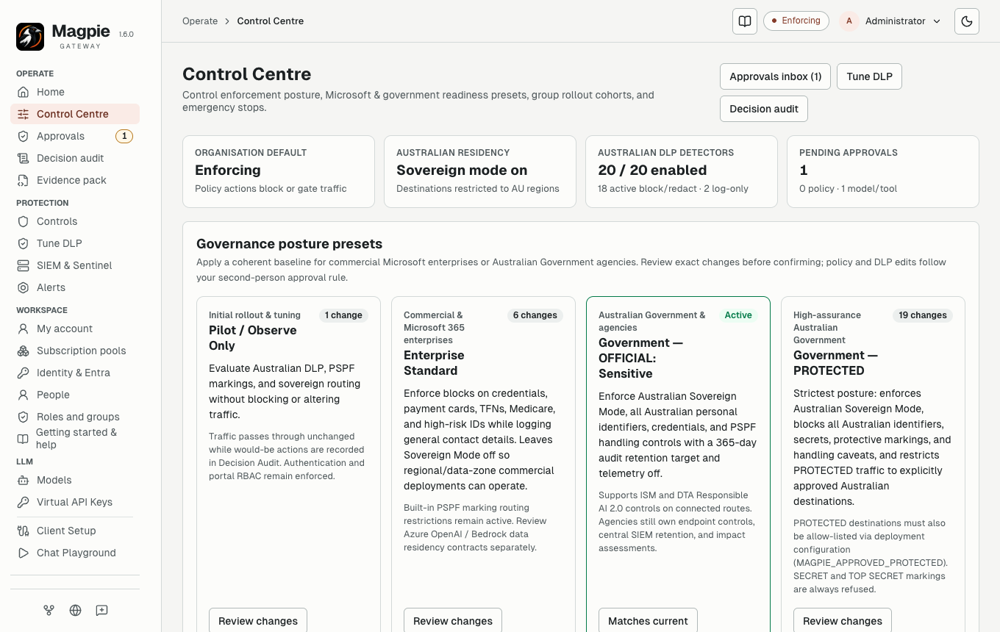
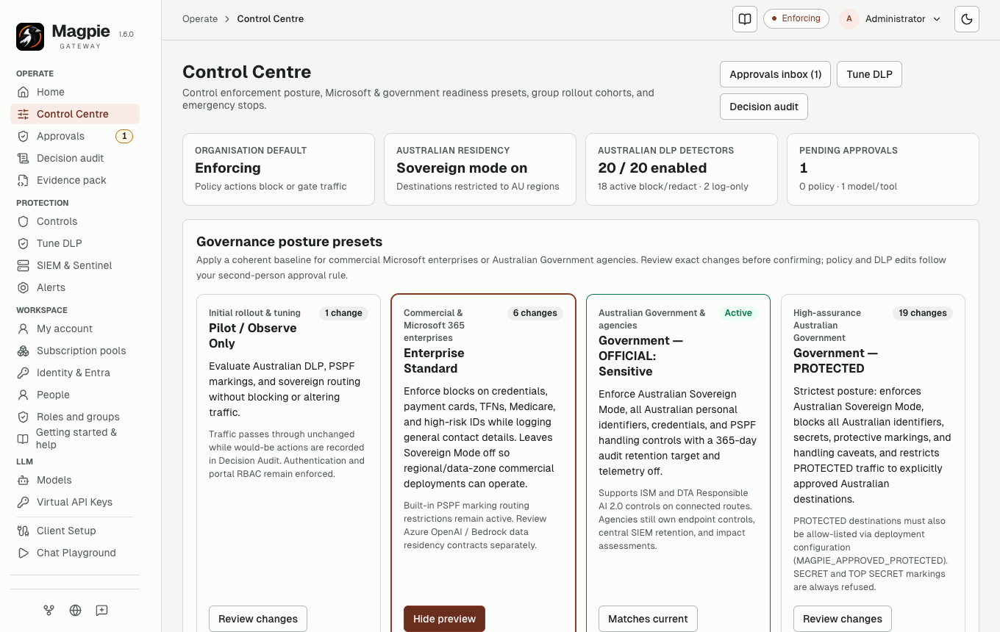

# Control Centre, posture presets and emergency kill switches

The **Control Centre** (`/ui/control-centre`) is the single operational cockpit for enterprise Microsoft and Australian Government administrators. From one screen you can inspect your live security posture, preview and apply governance baselines, roll out enforcement one Entra group at a time, adjust Australian residency settings, and trigger or clear emergency kill switches.

## Who this is for

- **Owner** and **Admin**: full control over posture presets, enforcement mode, cohort overrides, governance settings, and kill switches.
- **Policy Editor**, **Approver**, **Auditor**, **Viewer**: read-only visibility into active posture and preset diffs (controls outside a user's permissions are clearly disabled with the missing permission named).

## Understanding the four governance posture presets

Rather than configuring twenty DLP detectors, sovereign mode, retention targets, and enforcement mode across multiple screens, select a curated preset and review its exact changes before confirming:

| Preset | Target audience | Enforcement mode | Sovereign mode | DLP & PSPF baseline |
|---|---|---|---|---|
| **Pilot / Observe Only** | Initial rollout & false-positive tuning | `Log-only trial` | On | All AU DLP detectors active in observe mode; traffic passes unchanged while findings log |
| **Enterprise Standard** | Commercial & Microsoft 365 organisations | `Enforcing` | Off *(allows Azure Data Zone AP / Global)* | Blocks credentials, payment cards, TFN, Medicare, IHI, DVA, CRN, passport, licence, BSB/account; logs email, phone, address, ABN/ACN |
| **Government — OFFICIAL: Sensitive** | Australian Government agencies | `Enforcing` | On *(AU regions only)* | Enforces AU sovereign residency, all AU personal identifiers and secrets, PSPF routing rules, 365-day retention target, telemetry off |
| **Government — PROTECTED** | High-assurance Australian Government | `Enforcing` | On *(AU regions + approved PROTECTED list)* | Strictest posture: blocks all AU identifiers, secrets, protective markings, and handling caveats; PROTECTED traffic restricted to `MAGPIE_APPROVED_PROTECTED` |

::: important
Presets **preserve your existing exact-value DLP exceptions** so tuning work is never wiped out, and **leave the optional external Presidio analyser unchanged** so applying a preset never initiates unexpected external network requests.
:::

## Steps

### 1. Preview and apply a governance posture preset

1. Open **Operate → Control Centre**.
2. Review the four operational cards at the top: **Organisation default**, **Australian residency**, **Australian DLP detectors**, and **Pending approvals**.
3. On your chosen preset card (for example **Enterprise Standard** or **Government — OFFICIAL: Sensitive**), select **Review changes**.

   

4. Inspect every row in the **Preset changes** table:
   - **Immediate**: runtime controls such as **Organisation enforcement mode** take effect on the next request and are audited atomically.
   - **Pending second-person approval**: when second-person approval is enabled, governance settings and DLP detector changes are staged in the **Approvals** inbox so active rules stay untouched until a different authorised approver releases them.
5. Select **Apply / stage \<Preset name\>**.
6. If any policy or DLP changes were staged, open **Approvals** and ask a colleague with the **Approver** role to review and activate them (see Chapter 4).

### 2. Roll out enforcement one Microsoft Entra group at a time

You never have to switch the entire organisation from Trial to Enforcing in a single cutover:

1. Scroll to **Enforcement & staged cohort rollout**.
2. Read the **Readiness note** summarising the latest 200 gateway decisions (including how many would have blocked or altered traffic).
3. Keep **Organisation fallback mode** on **Log-only trial** while piloting.
4. In the **Group rollout cohorts** table, locate your pilot group (for example `SG-AI-Pilot-Engineers` synced from Entra ID, or `Admin group`).
5. Add any virtual gateway API key names belonging to pilot users in **Gateway key names** (one per line). Signed-in users also match by their Entra user ID, email, or prefix.
6. Set **Cohort mode** to **Enforcing** and select **Save**.
7. Only traffic matching that group is now enforced. If an unexpected block occurs, switch that group back to **Trial (log-only)** and select **Save** — rollback takes effect on the very next request without impacting any other group.

::: note
If a person belongs to both an **Enforcing** group and a **Trial** group, **Enforcing wins** (fail-safe precedence).
:::

### 3. Activate or clear an emergency kill switch

Use **Emergency kill switches** during a security incident, credential leak, or misbehaving autonomous agent:

1. Scroll to **Emergency kill switches** at the bottom-right of **Control Centre**.
2. **To halt a single runaway agent**: enter its agent ID in **Per-agent kill switch** (one ID per line) and select **Save per-agent list**. That agent's enforced requests are blocked immediately.
3. **To halt all enforced AI traffic globally**:
   - Tick **Confirm I want to block all enforced AI traffic immediately**.
   - Select **Activate global kill switch**.
   - An unmistakable red **Global kill switch is active** banner appears across the console for every signed-in user.
4. **To resume normal operations**: select **Clear global kill switch** (or remove the agent ID and select **Save per-agent list**).

## Verification

- Open **Operate → Decision audit** and confirm an atomic `settings` or `policy` audit record logged your mode, preset, cohort, or kill switch action with your user identity.
- Send a synthetic test prompt containing an example ABN (`ABN 12 000 000 041`) from a user in an **Enforcing** cohort and confirm it is blocked, while a user in a **Trial** cohort receives a response and logs `decision = log`, `wouldAction = redact`.
