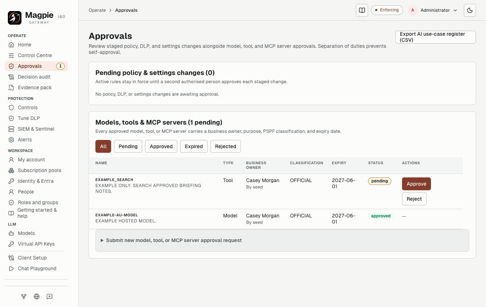

# Approvals and two-person change control

Magpie Gateway enforces separation of duties for both **staged configuration changes** (governance settings, DLP detectors, policy rules, and posture presets) and **AI asset approvals** (models, MCP servers, and tools). The **Approvals** inbox (`/ui/approvals`) brings both queues into one auditable screen with exact field diffs and DTA Responsible AI 2.0 use-case register export.

## Who this is for

- **Policy Editor** / **Admin**: submits policy, DLP, settings, and model/tool approval requests.
- **Approver** / **Owner** / **Admin (second person)**: reviews before/after diffs, checks expiry dates and PSPF classifications, and approves or rejects pending requests.
- **Auditor** / **Viewer**: reads approval status and exports the AI Use-Case Register.

## Separation-of-duties rules enforced by the server

Magpie enforces these rules atomically in the Rust portal API (not merely in the browser):

1. **No self-approval on revisions.** The user whose email matches `revision.actor` cannot approve their own staged policy, DLP, or settings change (`HTTP 403 Forbidden`).
2. **No self-approval on model/tool requests.** Neither the submitter (`updated_by`) nor the named **Business owner** can approve a model, tool, or MCP server approval request.
3. **Stale-revision protection.** If the active document changed while a revision was pending, approving the stale revision fails closed (`HTTP 409 Conflict`), automatically marks the stale revision rejected, and requires a fresh submission against the current active state.
4. **Expiry enforcement.** Approved models and tools automatically transition to **Expired** after their `expiresOn` date and are denied by enforced guardrails until renewed.

## Steps

### 1. Review and decide staged policy, DLP, or settings changes

1. Open **Operate → Approvals**. Notice the numeric badge in the sidebar showing total pending items.
2. In **Pending policy & settings changes**, inspect each card:
   - **Kind badge & Document ID** (for example `DLP rule · default-email` or `Governance settings · global`).
   - **Submitter and timestamp**.
   - **Structured diff lines** showing exact `before -> after` field transitions.
3. Verify the change aligns with your agency's change ticket and privacy assessment:
   - Select **Approve & activate** to commit the revision and update the live document atomically.
   - Select **Reject** to discard the staged change while keeping the active configuration untouched.
4. If you submitted the change yourself, **Approve & activate** is disabled with the explanation *"Separation of duties: a different authorised person must approve your change."*

### 2. Submit a new model, tool, or MCP server approval request

1. Scroll to **Models, tools & MCP servers** and expand **Submit new model, tool, or MCP server approval request**.
2. Fill in the mandatory DTA accountability fields:
   - **Name**: exact gateway model name (for example `azure-openai/gpt-5-au`) or MCP tool name (for example `sharepoint_search`).
   - **Type**: `Model`, `Tool`, or `MCP server`.
   - **Business owner**: accountable official or service owner (must differ from the person who will approve the request).
   - **Data classification**: `OFFICIAL`, `OFFICIAL: Sensitive`, or `PROTECTED`.
   - **Expiry date**: review date in `YYYY-MM-DD` format (annual review recommended).
   - **Purpose**: concise statement of approved agency use.
3. Select **Queue approval request**. The item enters the queue as `pending` (and remains denied by enforced guardrails until approved).

### 3. Approve, reject, and export the AI Use-Case Register

1. Use the filter buttons (**All**, **Pending**, **Approved**, **Expired**, **Rejected**) to focus the table.
2. As a second authorised approver, review the business owner, purpose, classification, and expiry date, then select **Approve** or **Reject**.
   - Approving an MCP **Tool** automatically regenerates the gateway's `approved-tools` CEL allow list.
3. Select **Export AI use-case register (CSV)** in the top-right header to download a CSV formatted with the DTA *Standard for accountability 2.0* field list for agency governance reporting.

## Verification

- Confirm the pending badge count in the sidebar decrements after approval or rejection.
- Open **Operate → Decision audit** and verify an `approval` or `policy` event recorded your email as the approver/reviewer.
- For an approved tool or model, confirm its status pill reads **approved** and test a synthetic call through the gateway.
