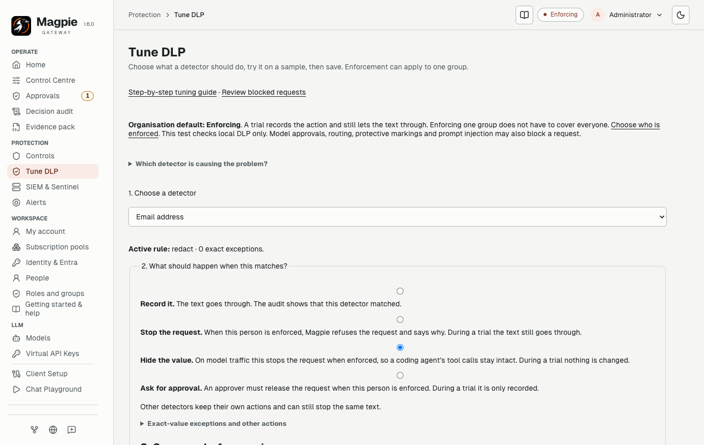
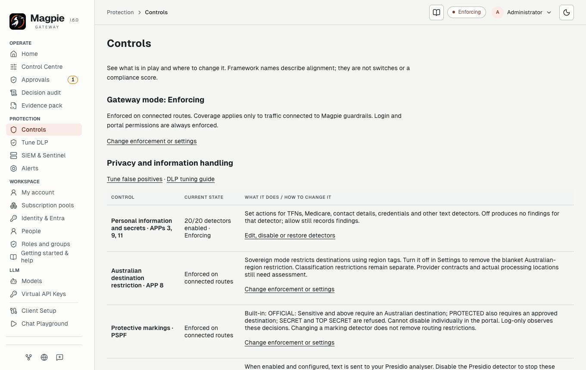

# Australian DLP, PSPF markings and false-positive tuning

Magpie Gateway ships with 20 built-in detectors tailored for Australian enterprises and government agencies — covering Australian Privacy Principles (APPs 3, 9, and 11), financial and healthcare identifiers, credentials/secrets, and Protective Security Policy Framework (PSPF) markings and handling caveats.

The **Tune DLP** screen (`/ui/dlp-tuning`) follows a safe four-step workflow: **Choose → Adjust → Compare → Save**. Preview samples are never stored, and exact-value exceptions are stored only as keyed HMAC fingerprints.

## Who this is for

- **Policy Editor**, **Admin**, **Owner**: tune detector actions, add or remove exact-value exceptions, disable noisy detectors, and submit changes for approval.
- **Auditor** / **Approver**: inspect active detector settings and recent finding counts.

## Built-in Australian detector coverage

| Category | Detectors | Notes |
|---|---|---|
| **Government & tax identifiers** | Tax File Number (TFN), ABN, ACN, Centrelink Reference (CRN), DVA Veteran ID | Checksum-validated for ABN (ABR), ACN (ASIC), and Medicare (ADHA) to minimise false positives |
| **Healthcare identifiers** | Medicare number, Individual Healthcare Identifier (IHI) | Supports APP 9 and health-sector privacy controls |
| **Identity & contact** | Australian Passport, Passport MRZ (ICAO check digit), Driver Licence (all states/territories), Email, Phone, Street address | Commonly tuned to `Log` for commercial email/phone while keeping `Redact`/`Block` on identity documents |
| **Financial & credentials** | Payment card (Luhn), BSB, Bank account number, Secrets & API keys | Detects cloud keys, bearer tokens, private keys, and connection strings |
| **PSPF markings & caveats** | Protective marking (`OFFICIAL`, `OFFICIAL: Sensitive`, `PROTECTED`, `SECRET`, `TOP SECRET`), Handling caveat (`CABINET`, `LEGAL PRIVILEGE`, `PERSONAL PRIVACY`, etc.) | **Built-in routing enforcement:** `OFFICIAL: Sensitive` and above require an AU destination; `PROTECTED` also requires `MAGPIE_APPROVED_PROTECTED`; `SECRET`/`TOP SECRET` are always refused. Disabling the marking *DLP detector* never removes PSPF routing protection. |
| **Optional external NLP** | External Presidio analyser | Off unless an administrator configures an internal Presidio URL in **Control Centre → Governance & residency settings** |

::: important
On LLM model requests in **Enforcing** mode, `Redact`, `Mask`, and `Tokenise` actions **block the request with a clear explanation** rather than rewriting prompt text mid-flight. Rewriting tool call arguments or conversation history silently breaks coding agents (Claude Code, Codex, Copilot). During **Log-only trial**, original traffic passes unchanged and the would-be action is logged.
:::

## Steps

### 1. Tune a detector using a synthetic sample

1. Open **Protection → Tune DLP** (or click **Tune \<detector\>** directly beside a finding in **Decision audit**).
2. Under **1. Choose a detector**, select the detector generating false positives (for example **Email address** or **Phone number**). Recent finding counts from Decision Audit appear beside active detectors.
3. Under **2. Choose what Magpie should do**, pick the desired plain-language outcome:
   - **Record it (`log`)**: pass traffic and record the finding in Decision Audit.
   - **Stop the request (`block`)** or **Hide the value (`redact`)**: block enforced model requests and record the finding.
   - **Ask for approval (`requireApproval`)**: gate enforced requests for approval.
4. *(Optional)* Expand **Exact-value exceptions and other actions** if a specific public value (such as a generic service-desk phone number `1300 000 000` or public agency email `enquiries@agency.gov.au`) should be ignored while keeping the detector strict for everything else:
   - Enter the **Exact value to ignore** (never supported for PSPF protective markings or caveats).
   - Enter a short **Exception label** that does *not* repeat the raw value (for example `Public switchboard number`). Magpie stores only a keyed HMAC-SHA256 fingerprint — the original value cannot be read back later.
5. Under **3. Compare with a synthetic sample**, paste a harmless test sentence (never real citizen data) and select **Compare active and draft**.
6. Inspect the side-by-side **Active DLP** vs. **Draft DLP** decision and **Sanitised preview**. Confirm the raw sensitive value never echoes in the preview.
7. Select **Save for approval** (or **Save rule** when second-person approval is off).

### 2. Review effective framework coverage

1. Open **Protection → Controls** to inspect the plain-language inventory across **Privacy and information handling (APPs & PSPF)**, **ASD ISM**, and **Essential Eight**.

   

2. Expand **See all eight strategies and their owners** to verify which Essential Eight strategies are partially supported by the gateway (RBAC and Entra MFA) and which remain owned by Microsoft Intune, Defender, and infrastructure patching.

## Verification

- Confirm the detector row shows `Pending approval` until a second approver activates it in **Approvals**.
- After activation, re-run **Compare active and draft** with your synthetic sample and verify **Active DLP** matches your intended decision.
- Confirm your original exact-value exception string does **not** appear in `/api/magpie/dlp` or `/api/export`.
