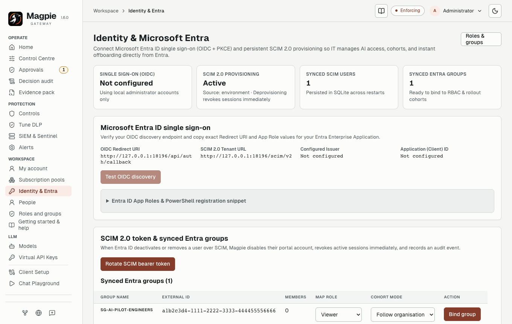

# Microsoft Entra ID SSO and persistent SCIM 2.0 provisioning

Magpie Gateway integrates natively with **Microsoft Entra ID** for OpenID Connect (OIDC + PKCE) single sign-on, Entra App Roles, Conditional Access / phishing-resistant MFA, and persistent **SCIM 2.0** user and group provisioning. When a staff member leaves or is removed from an Entra assignment, SCIM deactivation immediately disables their Magpie account and revokes all active browser sessions.

## Who this is for

- **Microsoft Entra ID Application Administrator / Cloud Application Administrator**
- **Magpie Owner** or **Access Administrator** (holding `ManageAccess`)



## How Entra ID and SCIM work together in Magpie

| Capability | Protocol / Mechanism | Operational benefit |
|---|---|---|
| **Portal sign-in** | OIDC Authorization Code Flow with PKCE (`S256`), `nonce`, `state`, and HttpOnly `SameSite` login cookie | No local passwords for day-to-day users; inherits Entra Conditional Access, FIDO2/Passkey MFA, and sign-in logs |
| **Role assignment** | Entra App Roles (`Magpie.Owner`, `Magpie.Admin`, `Magpie.PolicyEditor`, `Magpie.Approver`, `Magpie.Auditor`, `Magpie.Viewer`) or Entra Security Group GUIDs | Zero manual role editing when staff join or change teams |
| **Directory persistence** | SQLite `scim_users` and `scim_groups` tables | Synced users and groups survive container restarts and upgrades |
| **Instant offboarding** | SCIM `PATCH /scim/v2/Users/{id}` (`active: false`) or `DELETE` | Immediately disables the matching `portal_users` record, deletes all active rows in `sessions`, and writes an `access` audit event |
| **Cohort binding** | **Bind group** on **Identity & Microsoft Entra** | Maps a synced Entra security group by display name and `externalId` straight into a Magpie RBAC & rollout cohort — no manual GUID copy-paste |

## Steps

### 1. Register Magpie Gateway in Microsoft Entra ID

1. Open **Workspace → Identity & Entra** (`/ui/identity`).
2. Copy the exact **OIDC Redirect URI** (`https://<your-magpie-host>/api/auth/callback`) and **SCIM 2.0 Tenant URL** (`https://<your-magpie-host>/scim/v2`).
3. Expand **Entra ID App Roles & PowerShell registration snippet**, or run the automated PowerShell step:

   ```powershell
   ./deploy/Deploy-MagpieAzure.ps1 `
       -TenantId '<tenant-guid>' `
       -SubscriptionId '<subscription-guid>' `
       -NamePrefix 'magpieagency' `
       -PublicUrl 'https://magpie.agency.gov.au' `
       -Step Entra
   ```

4. In the Microsoft Entra admin centre (**Enterprise applications → Magpie Gateway → Properties**):
   - Set **Assignment required?** to **Yes** so only explicitly assigned users or groups can authenticate.
   - Attach your agency's **Conditional Access** policy requiring phishing-resistant MFA (Essential Eight Maturity Level 2/3) and compliant/managed devices.
   - Under **Users and groups**, assign your security groups to the appropriate `Magpie.*` App Roles.
5. Configure the deployment environment variables (or Azure Key Vault secrets via Terraform):
   - `MAGPIE_ENTRA_TENANT_ID=<tenant-guid>`
   - `MAGPIE_OIDC_CLIENT_ID=<app-id>`
   - `MAGPIE_OIDC_CLIENT_SECRET=<client-secret>` *(stored in Key Vault)*
   - `MAGPIE_PUBLIC_URL=https://<your-magpie-host>`

### 2. Verify OIDC discovery from the console

1. Return to **Workspace → Identity & Entra**.
2. Confirm **Single sign-on (OIDC)** shows `Connected (ENTRA)` and the resolved issuer reads `https://login.microsoftonline.com/<tenant-guid>/v2.0`.
3. Select **Test OIDC discovery**.
4. Confirm the green banner reports **OIDC discovery reachable** along with the verified `authorizationEndpoint`, `tokenEndpoint`, and `jwksUri`.

### 3. Enable SCIM 2.0 automatic provisioning & offboarding

1. In **Workspace → Identity & Entra**, select **Generate SCIM bearer token** (or **Rotate SCIM bearer token**).
2. Copy the `mp_scim_...` token from **New SCIM secret token (shown once)**. It is never displayed again.
3. In Microsoft Entra admin centre, open **Enterprise applications → Magpie Gateway → Provisioning**:
   - Set **Provisioning Mode** to **Automatic**.
   - Enter **Tenant URL**: `https://<your-magpie-host>/scim/v2`.
   - Paste the **Secret Token** (`mp_scim_...`).
   - Select **Test Connection** and confirm Entra reports success (`GET /scim/v2/ServiceProviderConfig` returns HTTP 200).
   - Enable **Provision Azure Active Directory Users** and **Provision Azure Active Directory Groups**, then select **Start provisioning**.

### 4. Bind a synced Entra group to RBAC and a rollout cohort

1. After Entra's initial sync cycle completes, refresh **Workspace → Identity & Entra**.
2. Locate your group under **Synced Entra groups** (for example `SG-AI-Pilot-Engineers`).
3. Choose the target **Map role** (for example `Viewer` or `Admin`) and **Cohort mode** (`Follow organisation`, `Trial (log-only)`, or `Enforcing`).
4. Select **Bind group**. The group is now linked by its stable Entra object ID and immediately appears in **Control Centre → Group rollout cohorts**.

## Verification

- Sign in as a test Entra user assigned to `Magpie.Auditor` and confirm they receive read-only audit/evidence access and cannot edit gateway configuration (`HTTP 403`).
- In Entra ID, remove the test user from the assigned group (or disable them) and trigger **Provision on demand**. Confirm **Synced SCIM users** flips their status pill to **Disabled** and their open Magpie browser session is immediately signed out on the next API call (`HTTP 401`).
- Confirm **Decision audit** contains `SCIM provisioning bearer token rotated.` and `Portal user disabled.` events.
