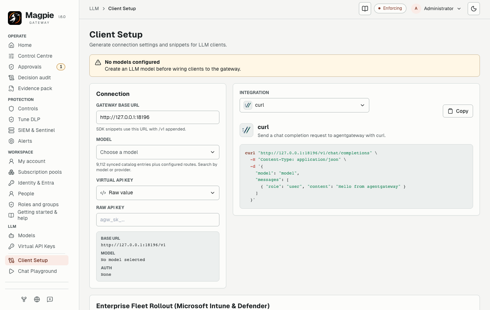

# Enterprise endpoint rollout with Microsoft Intune and Defender

Individual developers can configure coding tools manually from **LLM → Client Setup**, but enterprise Microsoft organisations and government agencies need repeatable, tamper-resistant workstation deployment across hundreds or thousands of Windows and macOS devices.

Magpie Gateway generates **secret-free Microsoft Intune PowerShell remediation scripts** and **Microsoft Defender for Endpoint indicator CSVs** directly from **LLM → Client Setup** (`/ui/llm/client-setup`), pre-populated with your live gateway URL and MCP endpoint.

## Who this is for

- **Microsoft Intune / Modern Workplace Administrators**
- **Endpoint Security Engineers (Microsoft Defender for Endpoint & App Control for Business)**
- **Developer Experience Leads**

## Managed configuration targets by coding agent

Paths and registry policies follow vendor specifications verified in `docs/windows-endpoint.md`:

| Coding agent | Windows managed file | Windows HKLM Registry policy | macOS managed location | What Magpie enforces |
|---|---|---|---|---|
| **Claude Code** | `C:\Program Files\ClaudeCode\managed-settings.json` | `HKLM\SOFTWARE\Policies\ClaudeCode` (`Settings`, `REG_SZ`) | `/Library/Application Support/ClaudeCode/managed-settings.json` | Sets `ANTHROPIC_BASE_URL` to Magpie `/v1`, sets `DISABLE_TELEMETRY=1`, restricts MCP servers to `https://<magpie>/mcp` (`allowManagedMcpServersOnly: true`) |
| **Codex CLI** | `%ProgramData%\OpenAI\Codex\requirements.toml` | *(Platform script — no vendor ADMX)* | `/etc/codex/requirements.toml` (or MDM `com.openai.codex`) | Locks `[mcp_servers.magpie]` streamable HTTP identity to `https://<magpie>/mcp` |
| **VS Code & GitHub Copilot** | `%ProgramFiles%\GitHubCopilot\managed-settings.json` | `HKLM\SOFTWARE\Policies\GitHubCopilot` (`ChatMCP = registryOnly`) | `/Library/Application Support/GitHubCopilot/managed-settings.json` | Restricts MCP access to registry/approved endpoints (`allowedMcpServers` pointing at `https://<magpie>/mcp`) |

::: important
**Never embed a shared API key inside an Intune script or Win32 app.** Every developer or workstation must hold an individual **Virtual API Key** (or Entra-issued credential) so Decision Audit and group enforcement cohorts attribute every request to a named person and allow instant per-user revocation.
:::

## Steps

### 1. Generate Intune remediation scripts from Magpie

1. Open **LLM → Client Setup** (`/ui/llm/client-setup`).
2. Verify **Gateway base URL** matches the external HTTPS URL reachable from corporate workstations (for example `https://magpie.agency.gov.au`).
3. Scroll to **Enterprise Fleet Rollout (Microsoft Intune & Defender)**.
4. Choose your target coding agent tab:
   - **Claude Code (Intune)**
   - **Codex CLI (Intune)**
   - **VS Code & GitHub Copilot (Intune)**
5. Review the generated PowerShell script in the preview panel and select **Download Intune Remediation (.ps1)** (and **Download Intune Detection (.ps1)** for Claude Code).

### 2. Deploy via Microsoft Intune (Scripts and remediations)

1. Sign in to the **Microsoft Intune admin center** (`https://intune.microsoft.com`).
2. Navigate to **Devices → Scripts and remediations → Remediations → Create**.
3. Give the package a clear name (for example `Magpie Gateway — Managed Claude Code Policy`).
4. Upload the downloaded Detection script and Remediation script with these execution settings:
   - **Run this script using the logged-on credentials**: **No** *(must run as SYSTEM to write `Program Files`, `ProgramData`, and `HKLM\SOFTWARE\Policies`)*
   - **Enforce script signature check**: **Yes** *(sign the `.ps1` with your organisation's internal code-signing certificate before production rollout)*
   - **Run script in 64-bit PowerShell**: **Yes**
5. Assign first to your **Pilot device group** (matching your `SG-AI-Pilot-Engineers` cohort in Magpie), then expand to broader rings once verified.

### 3. Constrain direct public endpoints in Microsoft Defender for Endpoint

Managed settings steer compliant tools toward Magpie, while **Microsoft Defender for Endpoint** network protection prevents shadow bypass to unapproved public model hosts:

1. In **Enterprise Fleet Rollout**, select **Download Defender Indicators (.csv)**.
2. Open the CSV and review every row carefully before importing:
   - `Allow` row for your Magpie Gateway domain (`magpie.agency.gov.au`), `GenerateAlert = FALSE` or `TRUE` per SOC policy.
   - Reviewable template rows (`Warn` by default) for direct public LLM hosts (`api.openai.com`, `api.anthropic.com`). **Confirm which hosts your agency still permits before changing `Warn` to `Block`.**
3. In **Microsoft Defender XDR** (`https://security.microsoft.com`), navigate to **Settings → Endpoints → Indicators → URLs/Domains → Import** and upload your reviewed CSV.
4. For **Essential Eight Application Control**, manage signed `claude`, `codex`, and `Code.exe` publisher rules separately via **Windows App Control for Business (WDAC)** in a pilot ring.

## Verification

- On a pilot Windows workstation, run `Test-Path 'C:\Program Files\ClaudeCode\managed-settings.json'` and inspect `Get-ItemProperty HKLM:\SOFTWARE\Policies\ClaudeCode` to confirm policy delivery.
- Issue the pilot user a named **Virtual API Key** (matching their name or Entra group in **Control Centre**), send a harmless prompt from the coding agent, and confirm the request appears in **Operate → Decision audit** attributed to that user.
- Attempt a direct `Invoke-WebRequest https://api.anthropic.com` from a Defender-protected pilot machine once `Block` indicators are active, and confirm Defender blocks and alerts as expected.
