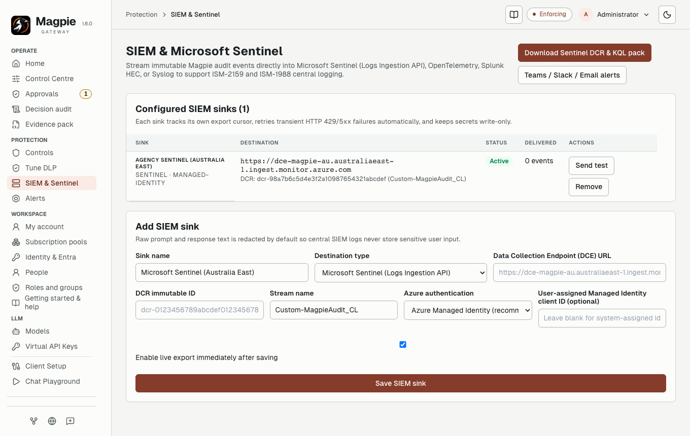

# Microsoft Sentinel, SIEM streaming and Teams security alerts

To support **ISM-2159** (central logging of agentic tool invocations, external requests, and outputs) and **ISM-1988** (at least 12 months of searchable retention), Magpie Gateway streams immutable audit events continuously into **Microsoft Sentinel** (via the Logs Ingestion API using Azure Managed Identity or Entra client credentials), **OpenTelemetry (OTLP/HTTP JSON)**, **Splunk HEC**, or **Syslog**, and delivers real-time security notifications to **Microsoft Teams Adaptive Cards**, Slack, webhooks, or email.

## Who this is for

- **SOC Analysts & Microsoft Sentinel Engineers**
- **Cloud Platform / Azure Administrators**
- **Security Operations Managers**



## Architecture of Magpie-to-Sentinel delivery

1. Every guardrail decision, MCP tool check, approval, access update, and kill switch change is appended to Magpie's immutable `audit_events` table.
2. Magpie's background SIEM worker (`siem.rs`) polls each enabled sink every 5 seconds, tracking an **independent cursor (`audit_sink_cursors`) per sink** so enabling a new sink starts from current events without flooding your workspace with historical noise.
3. For **Microsoft Sentinel**, Magpie acquires a short-lived OAuth2 bearer token for `https://monitor.azure.com/` (passwordlessly via **Azure Managed Identity** on Azure Container Apps, or via Entra **Client Credentials** when hosted on AWS/on-premises) and posts batches of up to 512 records to:

   ```text
   POST <DCE_ENDPOINT>/dataCollectionRules/<DCR_IMMUTABLE_ID>/streams/Custom-MagpieAudit_CL?api-version=2023-01-01
   ```

4. Transient failures (`HTTP 429`, `502`, `503`, `504`, or network outage) retain the cursor and retry with backoff.
5. **Privacy by default:** Raw prompts and completions are excluded (`capturePayloads = false`), sending only structured metadata (`TimeGenerated`, `EventId`, `Kind`, `Actor`, `AgentId`, `Tool`, `Model`, `Decision`, `Reason`, and redacted `Detail` keys).

## Steps

### 1. Deploy the Microsoft Sentinel DCE, DCR and custom table

If you deployed Magpie with the Azure Terraform module (`deploy/terraform/azure/` with `enable_sentinel = true`), the Log Analytics workspace, Sentinel onboarding, Data Collection Endpoint (DCE), Data Collection Rule (DCR) for `Custom-MagpieAudit_CL`, and **Monitoring Metrics Publisher** role for Magpie's Managed Identity are already provisioned. Retrieve the values with:

```powershell
cd deploy/terraform/azure
terraform output sentinel_dce_endpoint
terraform output sentinel_dcr_immutable_id
terraform output managed_identity_client_id
```

If you are wiring into an **existing** Microsoft Sentinel workspace:

1. Open **Protection → SIEM & Sentinel** (`/ui/siem`).
2. Select **Download Sentinel DCR & KQL pack** (`magpie-sentinel-pack.json`).
3. Create the custom table `MagpieAudit_CL` and DCR in Azure Monitor using `dataCollectionRuleStreamDeclaration` from the downloaded pack, and grant Magpie's Managed Identity (or Entra app registration) the **Monitoring Metrics Publisher** RBAC role on the DCR.

### 2. Configure and test the Sentinel sink in the console

1. Open **Protection → SIEM & Sentinel** (`/ui/siem`).
2. Under **Add SIEM sink**:
   - **Sink name**: `Agency Sentinel (Australia East)`.
   - **Destination type**: `Microsoft Sentinel (Logs Ingestion API)`.
   - **Data Collection Endpoint (DCE) URL**: paste your `https://dce-...ingest.monitor.azure.com` URL.
   - **DCR immutable ID**: paste `dcr-...`.
   - **Stream name**: keep `Custom-MagpieAudit_CL`.
   - **Azure authentication**: choose **Azure Managed Identity (recommended on Azure)** and optionally enter the User-Assigned Managed Identity Client ID (or choose **Entra App Registration** when running outside Azure).
   - Tick **Enable live export immediately after saving** and select **Save SIEM sink**.
3. In the **Configured SIEM sinks** table, select **Send test** beside your Sentinel sink.
4. Confirm the green banner reports **Delivered synthetic test event**.

### 3. Import the six built-in Sentinel KQL detection rules

The downloaded `magpie-sentinel-pack.json` (and `detections/sentinel/*.kql` in the repository) contains six ready-to-schedule Microsoft Sentinel Analytics Rules:

| Rule file | What it detects | Recommended severity |
|---|---|---|
| `credential-in-arguments.kql` | API keys, bearer tokens, or private keys detected in prompts or MCP tool arguments | High |
| `blocked-destination.kql` | Attempts to send data to non-Australian or unapproved PROTECTED destinations | High |
| `unapproved-tool.kql` | Agents attempting to invoke an unapproved or expired MCP tool | Medium |
| `dlp-block-spike.kql` | Abnormal burst of Australian DLP hits (TFN, Medicare, payment cards) from a user or agent | Medium |
| `tool-call-spree.kql` | Autonomous agent tripping MCP tool rate limits | Medium |
| `after-hours.kql` | AI gateway usage outside normal agency operating hours | Low / Informational |

### 4. Configure Microsoft Teams Adaptive Card alerts

For immediate SOC or platform-team visibility alongside Sentinel:

1. Open **Protection → Alerts** (`/ui/governance/alerts`).
2. Enter a **Destination name** (for example `SOC Teams Channel`), select **Send to → Microsoft Teams**, choose a trigger (**Security findings**, **Blocked traffic**, or **Policy and access changes**), and paste your Teams Power Automate Workflow webhook URL.
3. Save the destination (new destinations start disabled so you can review before activating), enable it, and send a test alert.
4. Magpie delivers structured **Adaptive Card v1.4** messages containing Event ID, Timestamp, Category, Decision, and Would-be action — with zero raw prompt text.

## Verification

- In Microsoft Sentinel **Logs**, run the KQL query below after 2–5 minutes (standard Azure Monitor ingestion latency) and verify your synthetic test event arrives:

  ```kql
  MagpieAudit_CL
  | where TimeGenerated > ago(30m)
  | project TimeGenerated, EventId, Kind, Actor, Decision, Reason
  | order by TimeGenerated desc
  ```

- Confirm **Delivered** event count increments in **Protection → SIEM & Sentinel** and **Last error** remains empty.
