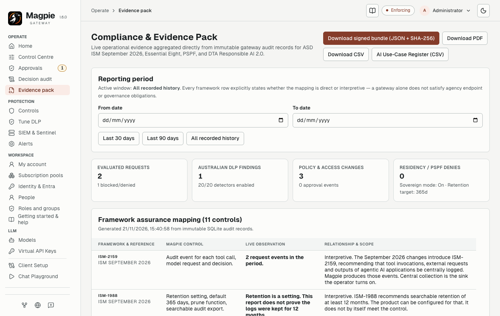

# Australian Government compliance and live evidence packs

Preparing monthly or quarterly governance evidence for an Information Technology Security Advisor (ITSA), IRAP assessor, or agency AI accountability committee typically requires stitching together spreadsheets and manual log exports.

Magpie Gateway's **Compliance & Evidence Pack** (`/ui/evidence`) aggregates live counts directly from your immutable `audit_events` table for any reporting window and produces **CSV**, **PDF**, **AI Use-Case Register CSV**, and a **SHA-256 verifiable JSON Assurance Bundle** in one click — while stating clearly and honestly what the gateway enforces versus what remains owned by your agency.

## Who this is for

- **Auditor** (`ReadAudit` + `ExportAudit`)
- **Owner** / **Admin** / **Approver**
- **ITSA / IRAP Assessor / Accountable AI Official**



## Frameworks covered and honest scope boundaries

Every row in Magpie's evidence output is explicitly labelled **Direct** or **Interpretive** and cites the official Australian Government source:

| Framework | References covered | Relationship & honest boundary |
|---|---|---|
| **ASD ISM (September 2026)** | `ISM-2159` (logging agentic AI tool invocations, requests, and outputs), `ISM-1988` (searchable retention >= 12 months), `ISM-1815` (protecting logs from modification/deletion) | **Interpretive.** Magpie generates the events and enforces SQLite append-only triggers; central retention and platform storage protection depend on your SIEM (Microsoft Sentinel) and Azure/AWS infrastructure controls. |
| **ASD Essential Eight (Nov 2023 model)** | Multi-factor authentication, Application control, Restrict administrative privileges | **Interpretive / Partial.** Portal login uses Entra OIDC (MFA enforced by Entra Conditional Access) and per-action RBAC restricts portal admin privileges. Workstation application control (WDAC), OS/app patching, macro hardening, and tested backups remain outside the gateway. |
| **DTA Policy for the responsible use of AI in government 2.0** | AI use-case accountability (*Standard for accountability 2.0*) | **Direct on field list only.** Magpie exports approvals using the DTA field structure; the agency retains ownership of the register, accountable official, and impact assessments. |
| **DTA Agentic AI Addendum (June 2026)** | `AGT.3` (Design — guardrails, kill switches, high-impact approvals), `AGT.4` (Data — classification & sovereignty), `AGT.7` (Integrate — tool allow lists & audit), `AGT.8` (Monitor — continuous monitoring & DLP review) | **Interpretive.** Magpie supplies technical enforcement and telemetry; workflow design and SOC monitoring remain agency responsibilities. |
| **PSPF & Australian Privacy Principles (APPs 3, 8, 9, 11)** | Sovereign routing, protective marking enforcement, 20 AU PII/secret detectors | **Operational control.** Verified in **Protection → Controls** and **Control Centre**. |

## Steps

### 1. Select your reporting period and review live counts

1. Open **Operate → Evidence pack** (`/ui/evidence`).
2. Choose a quick preset (**Last 30 days**, **Last 90 days**, **All recorded history**) or enter custom **From date** and **To date** values (for example a financial-year quarter `2026-07-01` to `2026-09-30`).
3. Review the four live operational cards:
   - **Evaluated requests** (and total blocked/denied decisions)
   - **Australian DLP findings** (and active enabled detector count)
   - **Policy & access changes** (and approval workflow events)
   - **Residency / PSPF denies** (and live Sovereign Mode + retention target)
4. Inspect each row in **Framework assurance mapping** to confirm observations reflect real activity (not zero-count placeholders).

### 2. Export your assurance deliverables

Select the format required by your committee or assessor from the top-right action bar:

| Export button | File generated | Best use |
|---|---|---|
| **Download signed bundle (JSON + SHA-256)** | `magpie-assurance-pack-YYYY-MM-DD.json` | Complete, tamper-evident assurance package containing SHA-256 digest, live stats, all framework rows, secret-free posture snapshot, and DTA use-case register |
| **Download PDF** | `magpie-evidence-YYYY-MM-DD.pdf` | Readable executive attachment for governance committees and monthly ITSA packs |
| **Download CSV** | `magpie-evidence-YYYY-MM-DD.csv` | Import into GRiCk, Excel, Power BI, or GRC registers |
| **AI Use-Case Register (CSV)** | `use-cases.csv` | Direct DTA *Standard for accountability 2.0* export of approved/pending models, tools, and MCP servers |

### 3. Verify the SHA-256 integrity of a downloaded assurance bundle

Any auditor can verify that an exported `magpie-assurance-pack-YYYY-MM-DD.json` file has not been modified after export using PowerShell or Python:

```powershell
$bundle = Get-Content .\magpie-assurance-pack-2026-11-21.json -Raw | ConvertFrom-Json
Write-Host "Recorded SHA-256: $($bundle.sha256)"
Write-Host "Generated by:     $($bundle.pack.generatedBy) at $($bundle.pack.generatedAt)"
Write-Host "Requests audited: $($bundle.pack.stats.requests) (Blocked: $($bundle.pack.stats.blocks))"
```

### 4. Offline CLI evidence export (optional)

Operators with access to a backed-up SQLite snapshot can also generate live CSV/PDF evidence offline:

```bash
cargo run --manifest-path magpie/Cargo.toml --bin magpie-evidence -- \
  --db /path/to/magpie.sqlite /tmp/magpie-evidence.pdf > /tmp/magpie-evidence.csv
```

## Verification

- Open **Operate → Decision audit** and confirm an `audit` event logged `Exported signed assurance bundle (...)` with your identity and reporting window.
- Confirm the exported JSON bundle contains **no API keys, provider credentials, client secrets, or raw exact-value DLP exceptions** (only `exceptionCount`).
